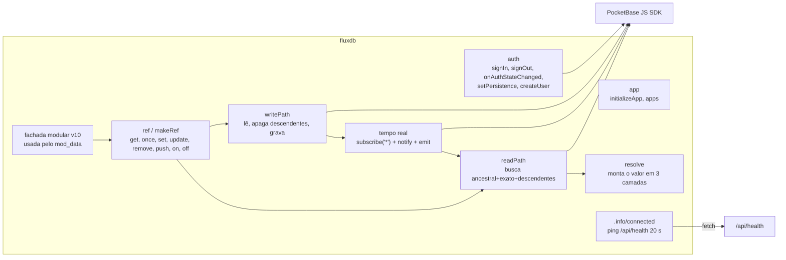
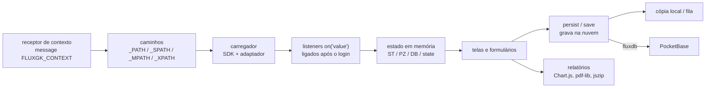

# C4 — Componentes (nível 3)

> Architect, 2026-10-13. Os dois containers que concentram o comportamento: o adaptador e um módulo típico.

## fluxdb (pocketbase-adapter.js)

## Módulo típico (padrão repetido em planner, stats, minutes, xg, periodization, profile, scouting)

| Componente | Variações relevantes | Confiança |
|---|---|---|
| Receptor de contexto | 8 módulos conferem `e.source`; `data` e `video` não | 🟢 |
| Persistência | por item (`planner`, `stats/games`, `minutes/games`, `data`, `profile`), documento único (`periodization`, `video`, `xg/games`) ou diferença (`scouting`) | 🟢 |
| Cópia local | fila com reenvio (`planner`), estado inteiro que sobe ao abrir (`data`), cópia simples (`scouting`, `xg`), mescla por lances (`video`) | 🟢 |
