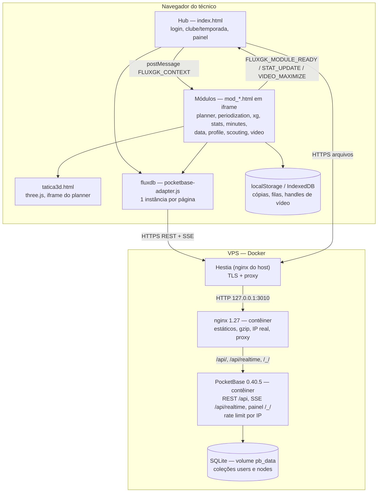

# C4 — Containers (nível 2)

> Architect, 2026-10-13.

| Container | Tecnologia | Responsabilidade | Confiança |
|---|---|---|---|
| Hub | HTML + JS inline | autenticação, contexto, painel | 🟢 |
| Módulos | HTML + JS inline, sem build | regras de cada domínio, relatórios, gráficos | 🟢 |
| fluxdb | JS (navegador) | tradução Firebase → PocketBase; tempo real | 🟢 |
| Armazenamento do navegador | localStorage, sessionStorage, IndexedDB | cópias de segurança, filas, preferências, handles | 🟢 |
| Hestia | nginx do host | TLS, domínio | 🟢 |
| nginx da stack | nginx 1.27-alpine | arquivos estáticos e proxy | 🟢 |
| PocketBase | Go, binário oficial | auth, REST, SSE, regras, painel | 🟢 |
| SQLite | arquivo em volume Docker | persistência | 🟢 |

**Observações**
- 🟢 Cada página aberta (hub + módulo) mantém sua própria conexão SSE e seu próprio `authRefresh`.
- 🟢 Não há servidor de aplicação: toda regra de negócio roda no navegador; o servidor só guarda e isola.
