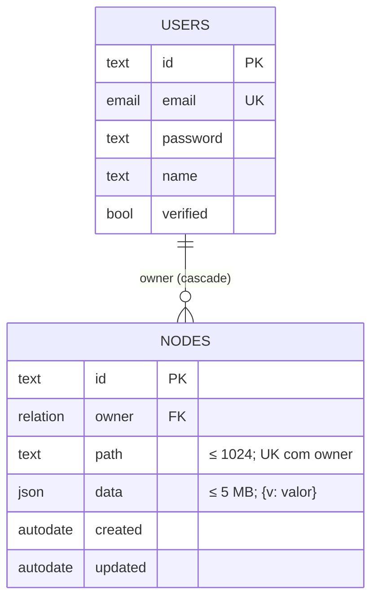
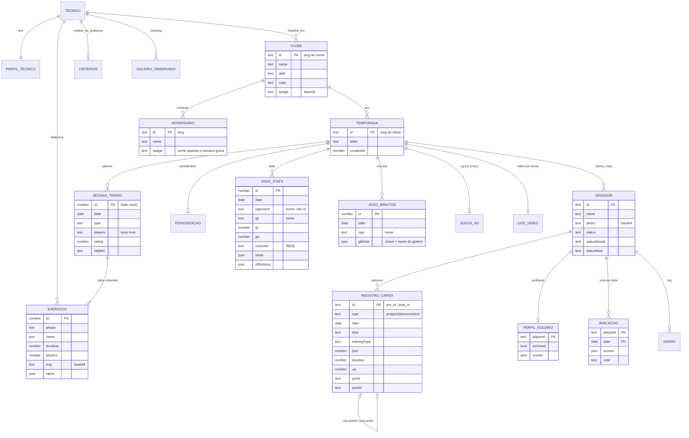

# ERD — FluxGK

> Architect, 2026-10-13. Dois níveis: o **físico** (o que o SQLite tem) e o **lógico** (o que as páginas gravam
> dentro de `nodes.data`). O servidor só conhece o físico; todas as relações lógicas são mantidas pelo navegador.

## Físico 🟢

## Lógico 🟢 (salvo onde marcado)

## Relações que só existem por convenção 🟢
| Relação | Como é mantida | Risco |
|---|---|---|
| Jogo (stats/minutes) → goleiro | **nome** em texto | renomear separa o histórico; não liga ao elenco do Load Control |
| Jogo → adversário | **nome** em texto; o adversário tem id = slug do nome | dois nomes iguais em grafias diferentes viram dois adversários |
| Sessão do planner → goleiros | texto separado por vírgula | sem vínculo com o elenco |
| Sessão do planner → exercícios | **cópia** do exercício | editar o exercício na biblioteca não altera sessões antigas (proposital 🟡) e duplica imagens |
| Pré ↔ pós | `postId` / `preId` | quebra já ocorreu; há reparo automático |
| Perfil, avaliação, diário → jogador | `playerId` do Load Control | jogador apagado deixa perfil órfão 🟡 |
