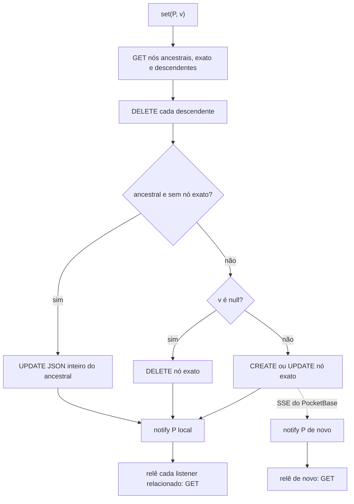

# Fluxo — `fluxdb`

> ⚠️ Este fluxograma é da **fluxdb 1.0** (extração de 13/10). A 1.1 (`e1dc8c7`) lê de uma cópia local e não relê pela
> rede; o fluxo atual está em `../adaptador-fluxdb/design.md`.

> Archaeologist, 2026-10-13. Detalhes e referências de linha em `../code-analysis.md`.

