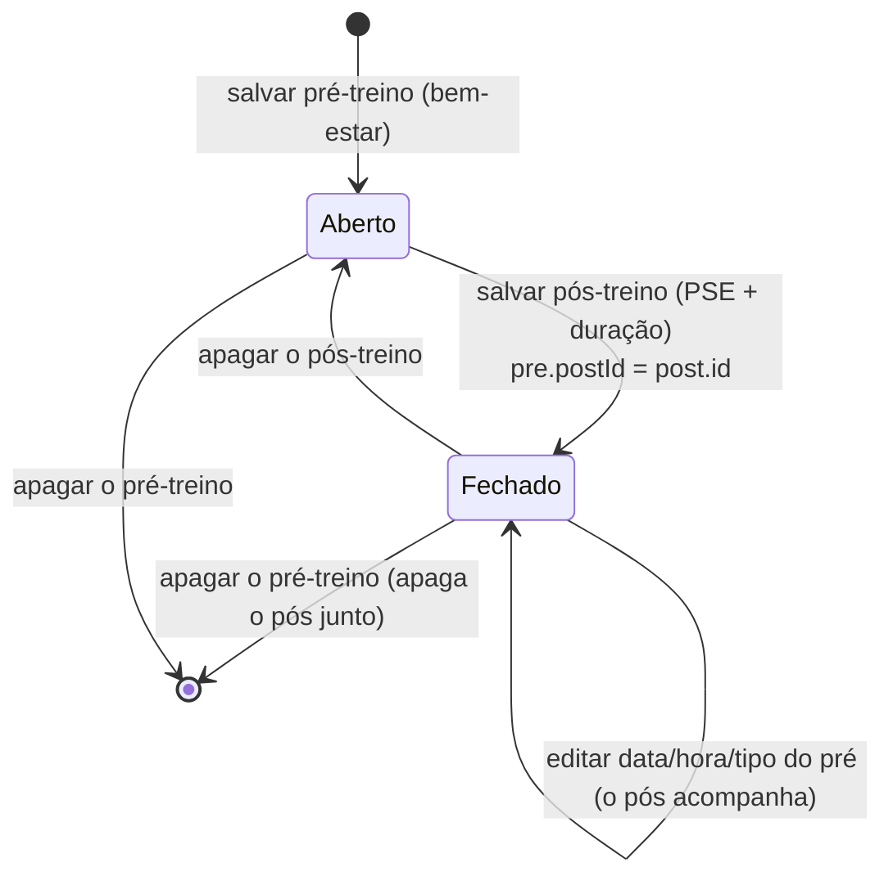
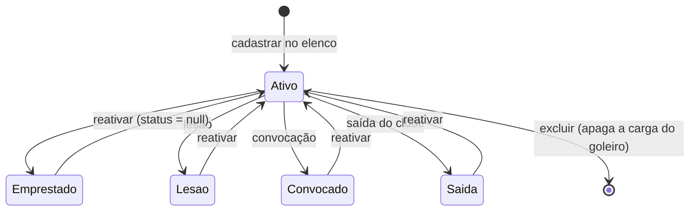
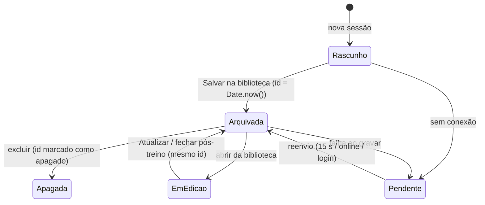
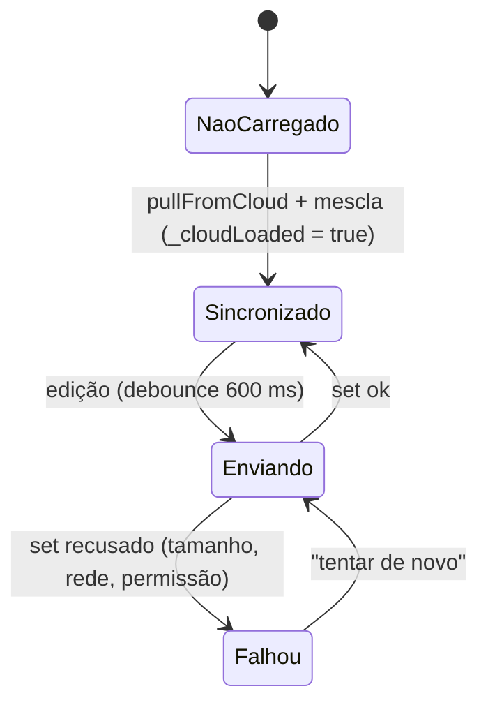

# Máquinas de estado — FluxGK

> Detective, 2026-10-13.

## Par pré/pós-treino (Load Control) 🟢

Um registro `pre` com `postId = null` está **aberto**; com `postId` preenchido, **fechado**.

Reparos automáticos ao abrir o módulo: `post.preId` existe e `pre.postId` vazio → refaz o vínculo; `pre.postId`
aponta para pós inexistente → solta o vínculo (`repairPrePostLinks`, `mod_data.html:1618`).

Registros sem par: `absence` (falta) e `rest` (descanso), estados finais em si mesmos.

## Status do goleiro (Load Control) 🟢

Campos `status`, `statusDesde`, `statusNota`. Vazio (ou `ativo`) = ativo.

🟡 Não há transição direta entre status fora do normal no código lido; troca-se passando por ativo ou regravando o status.

## Sessão de treino (planner) 🟢

## Gravação na nuvem do Video Lab 🟢

Antes do primeiro `pull`, nenhuma edição sobe, para não sobrescrever a nuvem com estado vazio.

## Contexto do módulo 🟢

`sem contexto` → (recebe `FLUXGK_CONTEXT` completo: `uid`, `dataPath`, `cloudConfig`) → `com contexto` → (login
confirmado) → `ouvindo`. Contexto incompleto é recusado com erro no console. Trocar de temporada volta a
"aguardando resposta" antes de mostrar a lista.
